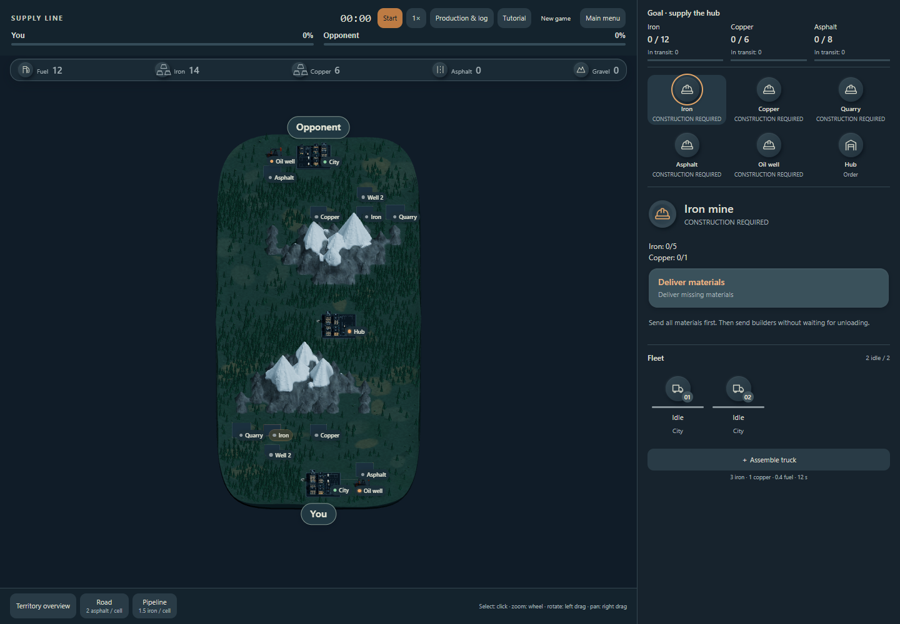

# Supply Line

**Two supply chains. One finish line.** A browser 3D strategy game where players build industrial supply chains and race to deliver resources. NEAR provides wallet identity and escrow for equal Testnet stakes; an authoritative server runs the match and reports its result.

**[Play Now](https://supply-line-game.vercel.app/) · [Play PvP](https://pvp-testnet-testnet.up.railway.app/pvp/) · [Judge's demo guide](HACKATHON_DEMO.md) · [Rust contracts & tests](contracts/README.md)**

> **NEAR Testnet only.** The public game uses a project-owned mock FT named “Test USDC”, not Circle USDC or real money. Mainnet escrow v2 is a separate, undeployed candidate. No real USDC is accepted.

## What is Supply Line?

Supply Line turns industrial logistics into a head-to-head race. Develop mines and factories, allocate building materials and crews, manage trucks and fuel, and connect production to the delivery hub. Win by delivering **12 iron, 6 copper and 8 asphalt** before your opponent.

### How it works

1. Build extraction and processing capacity; unfinished sites need materials and a construction crew.
2. Move ore and finished goods with trucks, connect oil by pipeline, and invest in roads to improve logistics.
3. Balance production, transport capacity and fuel while completing the hub's order.

PvP uses mirrored starting conditions, separate inventories and a shared road network. The server validates commands and advances both players at 1× speed. A browser's resources, clock or local victory flag cannot declare the winner.

## Game modes

| Mode | Entry | Wallet needed? |
| --- | --- | --- |
| Tutorial | **Play tutorial** on the main site | No |
| Solo vs Bot | **Race the bot** on the main site | No |
| Human PvP | **Play online**, then connect a Testnet wallet | Yes; test NEAR and the configured mock FT |

Desktop browsers with WebGL are the primary target. The public interface is English. Tutorial and bot are browser modes; human PvP runs on Railway.



## PvP & matchmaking

Create a **Public** lobby to appear in **Public Lobbies**, or choose **Private** and share its invitation link/code. Another connected player can join an open public seat without an invitation. Private means unlisted; anyone holding the invitation can use it.

Both players deposit the same agreed stake using their own wallets. The public UI accepts 1–100 mock tokens per player. Once both deposits are accepted on-chain and the countdown completes, the match starts. At 5 tokens each, the bank is 10: the configured 3% fee is 0.3 and the winner's prize is 9.7 mock tokens. Test NEAR gas/storage costs are separate.

**New wallets do not receive the game's mock token automatically.** Arrange funding before a judged PvP demo; [the preparation guide](HACKATHON_DEMO.md#prepare-two-wallets) explains the verified options. Tutorial and bot remain immediately playable.

## NEAR integration

- **Identity:** NEAR Connect wallet selection and NEP-413 message authentication; player keys stay in their wallets.
- **Deposits:** NEP-141 `ft_transfer_call` into escrow, bound to the match, stake, revision and fee terms.
- **Match lifecycle:** a restricted server key calls lobby, start, heartbeat and result methods. It does not sign player deposits.
- **Settlement:** escrow records winner/fee obligations and processes FT transfers with callbacks. The UI distinguishes `Ready`, `InFlight` and `Paid`; a game result alone is not a payout receipt.

The deployed escrow is **[`dev-20261105124711-29870979355191.testnet`](https://testnet.nearblocks.io/address/dev-20261105124711-29870979355191.testnet)**. The mock token is [`dev-20261105124714-71962479239708.testnet`](https://testnet.nearblocks.io/address/dev-20261105124714-71962479239708.testnet). [Live public configuration](https://pvp-testnet-testnet.up.railway.app/api/config) and [read-only verification snapshots](docs/verification/testnet-match-2.json) identify the network and token precisely.

**Verified Testnet settlement:** match #2 has both deposits accepted, a recorded winner and both payouts `Paid`. Its [settlement transaction](https://testnet.nearblocks.io/txns/8s6v7dfg8YqQYVSR6tiZfYNmgAZW5ArWT3GeYH2G2rE6) shows 9.7 mock tokens to the winner and 0.3 to the fee receiver. This is separate on-chain evidence beyond the user's reported two-wallet gameplay test; it establishes neither Mainnet readiness nor a security audit.

## Smart contract architecture

| | Public Testnet v1 | Future Mainnet v2 |
| --- | --- | --- |
| Status | Deployed and used by public PvP | Rust source and Sandbox-tested candidate; **not deployed on Mainnet** |
| Token | Project-owned six-decimal mock FT | Native Circle USDC pinned in the prepared architecture |
| Verification | Public code hash, match state and Testnet settlement | Rust tests, real local Sandbox receipts and reproducible candidate WASM builds |
| Boundary | Trusted server determines winner | Still trusts server result; independent audit and operational work remain |

**[Open the contract index →](contracts/README.md)** for pinned Rust source, ABI, unit/Sandbox tests and build reports. Important provenance limitation: rebuilding preserved v1 source has **not** reproduced the historical deployed WASM. v2 tests do not prove deployed v1 source equivalence. No Mainnet contract address is claimed.

## Technical architecture

| Component | Implementation / hosting |
| --- | --- |
| Browser game | JavaScript, Three.js 0.184.0, procedural/GLB assets; esbuild 0.25.12 |
| Static portal, tutorial, bot | Vercel; built from `main` |
| PvP client and wallet | NEAR Connect 0.12.0; separate Railway-served bundle |
| Authoritative server | Node.js 24+, HTTP polling, `near-api-js` 7.5.2 |
| Persistence and recovery | SQLite WAL, command journal, signed transaction outbox; one authority per database |
| Settlement | Rust escrow on NEAR Testnet; external restricted runtime signer |

The [repository verification report](docs/REPOSITORY_VERIFICATION.md) maps branches and open PRs to their deployment status. Railway is pinned to `f221951`; release/Mainnet PRs are not included in production.

## Repository structure

The default branch contains the playable static game. Runtime and candidate code are linked at immutable commits rather than merged into `main` for presentation.

| Location | Contents |
| --- | --- |
| [`prototypes/logistics-race/dist/`](prototypes/logistics-race/dist/) | Game economy, commands and interface |
| [`game-3d/`](prototypes/logistics-race/game-3d/) and [`threejs-trial/`](prototypes/logistics-race/threejs-trial/) | 3D scene, models and locked build dependencies |
| [`bot/`](prototypes/logistics-race/bot/) and [`share/`](prototypes/logistics-race/share/) | Bot race, tutorial/portal packaging |
| [Published PvP source](https://github.com/Monegask/hack/tree/f221951cf0bb280f2faae8c5f11b2a3795d75232/prototypes/logistics-race/pvp) | Wallet client, server, SQLite/outbox, tests and Railway Dockerfile |
| [`contracts/README.md`](contracts/README.md) | Contract source, ABI and test navigation, with provenance limits |
| [`scripts/`](scripts/) | Static build, local preview and read-only Testnet verification |
| [`HACKATHON_DEMO.md`](HACKATHON_DEMO.md) | Two-player demo and settlement checks |
| [`docs/REPOSITORY_VERIFICATION.md`](docs/REPOSITORY_VERIFICATION.md) | Branch inventory, evidence, checks and remaining gaps |

## Quick start

Use **Node.js 24 LTS** and npm. No wallet, backend or private key is needed for tutorial/bot builds.

```sh
git clone https://github.com/Monegask/hack.git
cd hack
npm ci --prefix prototypes/logistics-race/threejs-trial --include=dev
npm run build
npm test
npm start
```

Open **http://127.0.0.1:4186**. The preview serves the lazily loaded game and sends **Play online** to the existing public Testnet service. `npm run build` uses Vercel's build command and rebuilds autonomous HTML through `build-offline.cjs`. `exports/logistics-game.html` contains the portable tutorial/bot game.

To inspect and test the exact published backend without starting a signer/worker:

```sh
git worktree add --detach ../supply-line-testnet f221951cf0bb280f2faae8c5f11b2a3795d75232
cd ../supply-line-testnet
npm ci --prefix prototypes/logistics-race/threejs-trial --include=dev
npm ci --prefix prototypes/logistics-race/pvp
npm run build
npm run build --prefix prototypes/logistics-race/pvp
npm test --prefix prototypes/logistics-race/pvp
```

Operating a separate live backend requires an external restricted signer and persistent database; see the [versioned operator documentation](https://github.com/Monegask/hack/blob/f221951cf0bb280f2faae8c5f11b2a3795d75232/prototypes/logistics-race/pvp/README.md). Some dated sections are historical; use [the deployment report](https://github.com/Monegask/hack/blob/2b52daecac1b9a64a13a3333c19edb6b4b907b6c/docs/deployments/testnet-matchmaking-2026-11-14.md) for current hosting status. Never copy production keys or databases into a clone.

## How to test PvP

1. Prepare two separate Testnet wallets with test NEAR and this game's mock FT.
2. Player 1 opens **Play online**, connects, creates a **Public** lobby and chooses the test stake.
3. Player 2 connects another wallet, finds it in **Public Lobbies** and selects **Join**.
4. Both review terms and confirm their exact deposits in their wallets; wait for countdown.
5. Play the logistics race, then compare the escrow match ID, winner and payout states with final on-chain data.

See [the full judge's script](HACKATHON_DEMO.md) for funding, private invitations, recovery and result verification.

## Testing & verification

- Static build and 169 game regressions cover tutorial, bot, economy and 3D presentation.
- The deployed matchmaking source has 27 backend tests; its financial test transport is mocked.
- The separate integrated v2 candidate has passing [game/backend CI](https://github.com/Monegask/hack/actions/runs/43578830790), [contract CI](https://github.com/Monegask/hack/actions/runs/43578830808) and [backend/Rust Sandbox CI](https://github.com/Monegask/hack/actions/runs/43578830813). These are local Sandbox mock-FT settlements, not Mainnet payments.
- This submission adds a [Node 24 build/regression workflow](.github/workflows/submission.yml) for PRs to `main`; [current Actions status](https://github.com/Monegask/hack/actions).

Full scopes, exact commits, local results and unsupported claims are recorded in [Testing & repository verification](docs/REPOSITORY_VERIFICATION.md). Candidate load measurements use mocked RPC/FT and are not a Railway capacity guarantee.

## Roadmap

- Resolve contract provenance and financial recovery gaps; obtain independent professional security review.
- Complete wallet, infrastructure, backup/restore, monitoring and sustained real-RPC acceptance.
- Review account governance and requirements for monetary competitions.
- Only after those gates and a separate deployment decision: Mainnet escrow v2 and native Circle USDC.

## Hackathon demo

Start with **[the judge's demo guide](HACKATHON_DEMO.md)**. See the [public landing page screenshot](docs/media/public-menu.png) and the game screenshot above, captured on 14 November. A dedicated submission video has not yet been supplied. The live game, contract explorer and settlement evidence are available now.

## Security & limitations

This is a Testnet prototype. The server is a **trusted result oracle**, not trustless gameplay or an independent dispute system. Escrow exposes deposits/settlement; it does not prove the game on-chain. Admin authority and signer/deployment governance remain trust assumptions.

RPC interruptions and FT registration can delay progress. Disconnect grace is 120 seconds; both disconnected or simultaneous finish can require mutual cancellation or an emergency refund after 30 minutes without the match heartbeat. A pending/unknown transaction must be reconciled before retrying; `InFlight` is not `Paid`. Do not reset storage to “fix” a financial operation.

One server owns each SQLite database; horizontal replicas and production load capacity are not established. The v2 candidate retains issuer pause/blocklist and unresolved callback/resolver recovery risks. AI-assisted reviews are **not** independent professional audits. Intents and real-money play are not implemented in the public version.

## License & credits

The public repository is source-available; original game code/assets are **all rights reserved**, not licensed as an open-source game. See [LICENSE](LICENSE). The separately published escrow package has its own [MIT license](https://github.com/Monegask/hack/blob/6b6cd1c2f71dead588bbd41e400da9403bc599f8/contracts/near-pvp-escrow/LICENSE). Third-party licenses remain applicable.

The project uses AI-assisted code, Mint-generated models, generated illustrations/textures and procedural geometry; see [`mint-assets.json`](prototypes/logistics-race/mint-assets.json). Its initial GitHub commit imported an existing prototype; it is not the original development date.
