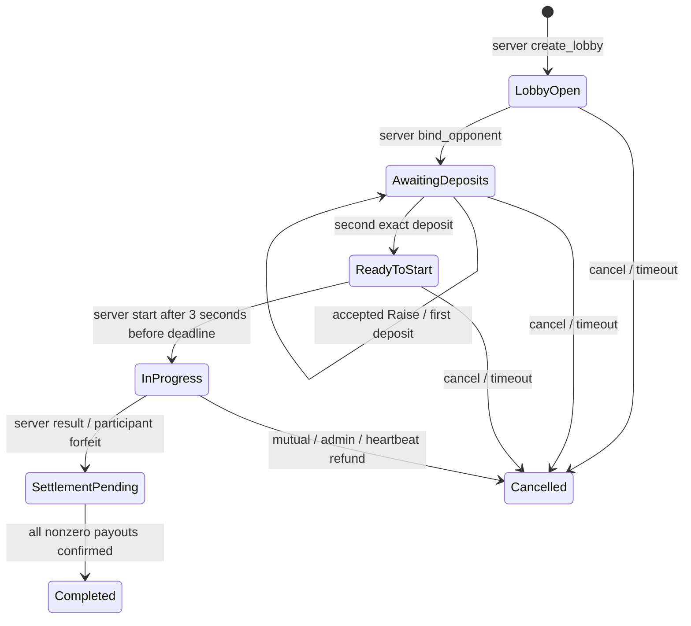

> Historical v1 import. Not current v2 instructions or fresh validation. See [candidate specification](docs/candidate/SPEC.md) and candidate migration/security documents. Do not run historical deployment commands for this candidate.

# Архитектура

## Границы ответственности

Клиент подключает личный кошелёк, показывает USDC и согласованные условия, строит одну транзакцию «Готов» и отображает подтверждённые состояния. Пополнение через Intents выполняется отдельно на личный кошелёк; escrow не выполняет обмены.

Backend хранит публичные/приватные лобби, коды приглашений, переговоры Raise, игровые данные и disconnect grace 120 секунд. Первый валидный запрос join атомарно занимает место в БД; сервер вызывает bind_opponent. При разрыве соединения обоих игроков сервер может организовать mutual cancel либо оператор делает admin refund. Серверный ключ не имеет права admin-cancel: финансовые полномочия разделены. AFK при сохранённом соединении не меняет состояние контракта.

Escrow хранит только состав, неизменяемый deadline и комиссию, revision/stake, флаги депозитов, heartbeat, результат и два обязательства. Ресурсов игры или лимита длительности активной партии в контракте нет.

## Модель состояний

`Negotiating` существует только в БД. On-chain AwaitingDeposits допускает изменение принятой ставки до первого депозита. `Cancelled` — финальное финансовое решение, возвраты могут ещё находиться в Ready/InFlight. `Completed` появляется только после подтверждения всех выплат.

Участие освобождается при фиксации результата или отмены. Это позволяет начать следующий матч, не блокируясь на регистрации получателя предыдущей выплаты. Поздний callback старого матча не меняет новый active index.

## Таймеры

Все времена — строки u64 наносекунд из block_timestamp. Границы включительные: при `now >= deadline` запуск/депозит запрещён; при `now >= last_heartbeat + 1800s` результат/forfeit запрещён и доступен возврат. Countdown требует полные 3 секунды от второго депозита, без округления до секунд.

Лобби регистрируется на chain при backend-создании, чтобы момент фиксации комиссии и дедлайн не зависели от последующих серверных изменений. Это обоснованное отступление от предпочтения полностью off-chain незаплаченных лобби. Нет фонового выполнения: expired lobby отменяет участник или keeper.

Heartbeat обновляет глобальное время и до 32 конкретных активных матчей. Истёкший heartbeat матча нельзя восстановить даже при работающем глобальном сервере. Отправляйте batch heartbeat каждые 30–60 секунд и следите за покрытием всех активных ID. Административная пауза не останавливает heartbeat, расчёт результатов и возвраты.

## Финансовый учёт

`accepted = locked + owed + paid`.

- Приём: accepted и locked увеличиваются на точную stake.
- Решение: locked уменьшается на банк/депозиты, owed увеличивается на ту же сумму.
- Dispatch: owed не меняется; выплата Ready -> InFlight с новым attempt.
- Успешный callback: owed уменьшается, paid увеличивается; выплата InFlight -> Paid.
- Ошибка FT: InFlight -> Ready без изменения owed.

Платежи winner и fee (либо оба refund) независимы. Комиссия — `floor(bank * fee_bps / 10000)`, вычисленная без опасного умножения большого банка; остаток получает победитель. Нулевой платёж сразу Paid и не вызывает запрещённый нулевой FT transfer.

Во время InFlight FT-баланс может уже уменьшиться до callback, а owed ещё включает перевод. Поэтому FT balance и owed нельзя сравнивать как синхронные значения. При отсутствии переводов в полёте баланс должен покрывать locked+owed; непрошенные прямые ft_transfer могут создать излишек. Метода присвоения такого излишка нет.

## Хранение и ресурсы

Монотонный u64 ID не переиспользуется, включая удалённые матчи. Хранятся не более 10 000 записей одновременно. Permissionless prune удаляет только Completed/Cancelled с Paid выплатами. Историю восстанавливает индексатор из `EVENT_JSON`.

Создание спонсируется операционным NEAR контракта, без attached deposit сервера. Перед новым лобби резервируется запас на 4096 storage bytes для каждой сохраняемой записи (включая новую) сверх текущего usage и 0.01 NEAR операционного остатка. Повторные выплаты не увеличивают число записей. Оператор следит за балансом и пополняет `fund`; NEAR и USDC никогда не смешиваются в учёте.

## Ограничения доверия

Сервер может подать ложный результат или продолжать heartbeat неисправного матча. Контракт проверяет полномочия, состав, состояния и деньги, но не истинность игрового результата. Администратор может делать только полные возвраты незавершённых матчей через обычный API. Обладатель deployment/full access key способен заменить код в обход Rust-политики; подробности в SECURITY.md.
